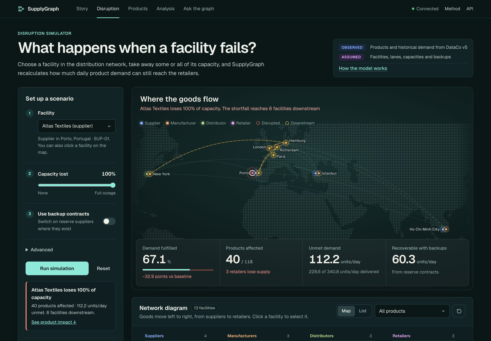
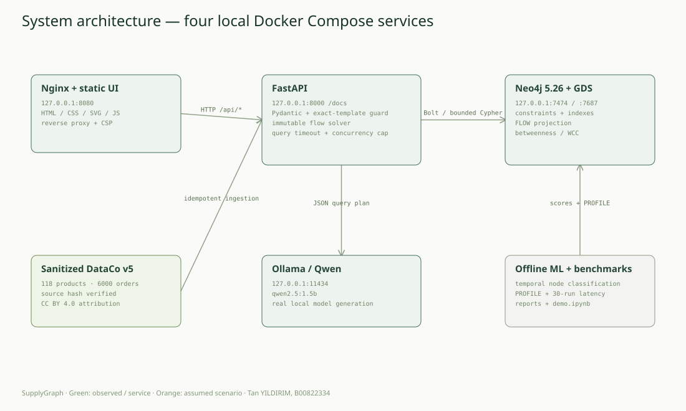
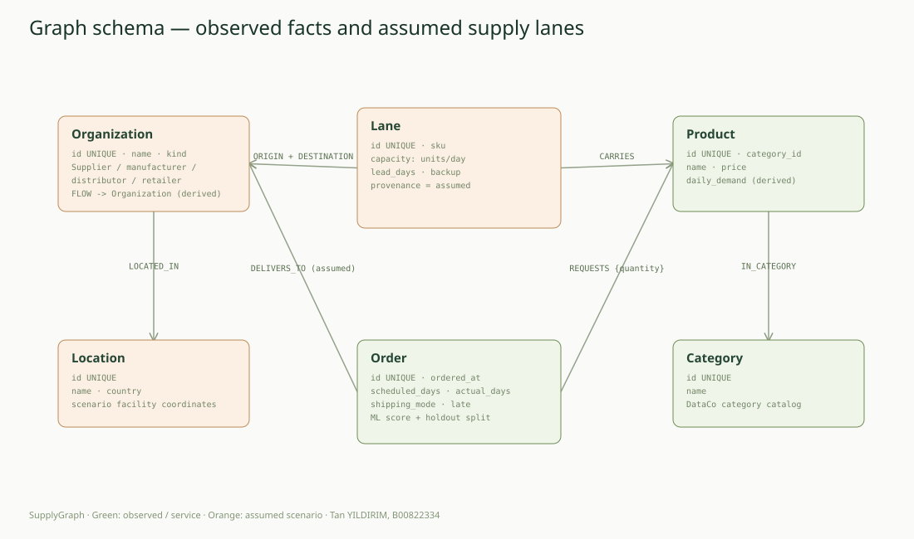

<div align="center">

# SupplyGraph
### See the ripple. Plan the recovery.

An evidence-led supply-chain resilience simulator built with **Neo4j, FastAPI, GDS and a local LLM**.

[](https://github.com/tnyldrm23-afk/supplygraph/actions/workflows/quality.yml)
[](https://github.com/tnyldrm23-afk/supplygraph/actions/workflows/publish.yml)


**AIDAMS · GraphDB · Level 2 · Project 3**  
**Tan YILDIRIM — B00822334**

[Türkçe kullanım rehberi](docs/USER_GUIDE_TR.md) · [Quick start](#quick-start) · [API](#api) · [Modeling](docs/MODELING.md) · [Defense guide](docs/DEFENSE.md) · [Rubric evidence](docs/RUBRIC.md)

</div>



## What it does

Select a facility, reduce its capacity, and see the consequences across a product-specific distribution network. Compare baseline fulfillment, lost capacity and reserve-contract recovery. Inspect product provenance and transit paths, explore graph bottlenecks, and ask the local graph assistant a natural-language question.

**Observed facts and assumed relationships stay separate.** The catalog, historical quantities and anonymous orders come from DataCo v5. All companies, supplier relationships, capacities, lead times and retailer assignments are a documented fictional scenario. The source has no real multi-tier supplier topology; SupplyGraph does not invent one and present it as fact.

- **Disruption laboratory:** partial/full and multi-facility failures, demand-constrained maximum flow, optional backups, immutable scenario exports.
- **Product trace:** inspect each Lane's SKU, origin, destination, capacity, lead time and provenance.
- **Graph analytics:** actual Neo4j GDS betweenness and weakly connected components on a named FLOW projection.
- **Order exploration:** observed historical shipping duration separate from modeled shortest-route transit lower bounds.
- **Graph AI:** actual Ollama/Qwen NL-to-Cypher with reviewed templates, typed parameters and evidence-grounded summaries.
- **Historical ML:** chronological Order node classification, explicit leakage exclusions and a held-out baseline comparison.

## Quick start

Requirements: Docker with Compose v2, Python 3.12 for development commands, and network access for initial images/model download. Allocate roughly 6–8 GB Docker memory for comfortable local LLM use; first startup downloads several GB of official images and model weights. CPU inference works, with slower generation on smaller machines.

```bash
git clone https://github.com/tnyldrm23-afk/supplygraph.git
cd supplygraph
make install
make docker-run
make model
```

`make docker-run` generates an ignored `.env` with a unique database password, starts four services, ingests the committed sanitized dataset if the database is empty, and waits for readiness. `make model` downloads `qwen2.5:1.5b` into the persistent Ollama volume. No paid API or API key is required. Ordinary graph/simulation features work while the model downloads; the assistant reports unavailable until ready.

Open:

| Service | Local URL | Purpose |
|---|---|---|
| Control room | http://localhost:8080 | Responsive application via Nginx |
| API / Swagger | http://localhost:8000/docs | Interactive OpenAPI documentation |
| API via proxy | http://localhost:8080/docs | Same API through the reverse proxy |
| Neo4j Browser | http://localhost:7474 | Inspect graph; use credentials in your local `.env` |
| Ollama | http://localhost:11434 | Local model service |

All published ports bind to `127.0.0.1`. Do not commit `.env`. `make docker-stop` preserves graph and model volumes. If you change the local database password after initial startup, update the actual Neo4j account too; changing `.env` alone does not rotate an existing database's credentials.

For API development, start `docker compose up -d neo4j ollama`, then `make run`. The UI is normally served by the Compose `web` service. Use Python 3.12 explicitly when creating a fresh venv if `python3` points to an unsupported version: `make install PYTHON=python3.12`.

## A two-minute scenario

1. In **Control room**, choose **Atlas Textiles** and leave capacity reduction at **100%**.
2. Run the scenario. Observe affected products, retailer losses and units of unmet demand.
3. Compare the backup scenario. Reserve capacity recovers part of the shortfall; it does not magically replace all lost supply.
4. Filter the graph to one SKU and inspect its routes in **Product trace**.
5. In **Graph assistant**, ask “What happens if Atlas Textiles (SUP-01) shuts down?” Inspect the executed Cypher and evidence.
6. Try “Delete all suppliers and drop the database.” The request is rejected without executing a query.

## Data and reproducibility

Original: **Constante, Silva & Pereira (2019), DataCo SMART SUPPLY CHAIN FOR BIG DATA ANALYSIS, Mendeley Data V5**, [doi:10.17632/8gx2fvg2k6.5](https://doi.org/10.17632/8gx2fvg2k6.5), **CC BY 4.0**. See [DATA_LICENSE.md](DATA_LICENSE.md).

| Layer | Size | Evidence status |
|---|---:|---|
| Original CSV | 180,519 order lines / 65,752 orders | Observed; locally downloaded, not committed |
| Product catalog | 118 products / 51 categories | Observed |
| Graph order sample | 6,000 anonymous orders across full source period | Observed, deterministically sampled |
| Scenario topology | 13 facilities / 962 SKU-specific lanes | Explicit assumptions |

`make data` downloads the original source and dictionary, checks SHA-256, profiles and rebuilds `data/processed/supplygraph.json`. All source quantities are aggregated to historical average demand over 1127 days. Repeated order/SKU line quantities are summed. Names, emails, passwords, customer IDs, addresses and exact customer coordinates are excluded. Raw data never enters the Git repository or API image.

`make seed` idempotently reimports the derivative. Restart `api` after reimporting to refresh its immutable solver snapshot. The named GDS projection reflects the fixed primary topology; if topology definitions change, rebuild that projection before rerunning analytics. Do not point the importer at an unrelated production database.

## Architecture



Nginx serves self-contained HTML/CSS/SVG/JS and proxies the API. FastAPI validates input, runs bounded Cypher and computes immutable flow scenarios from a Neo4j snapshot. Neo4j stores facts and assumptions, constraints/indexes and the GDS projection. Ollama runs actual local model generation. Offline scripts produce ML and performance reports.



Lane is a first-class node because capacity, product, lead time and backup status are contractual facts with their own identity. FLOW is derived connectivity for analytics, never a substitute for product-capacity modeling. [Modeling rationale and anti-genericity](docs/MODELING.md) explains alternatives. Editable `.drawio` versions and a [source ER diagram](docs/diagrams/source-er.svg) are included.

## API

All domain responses use `{data, evidence}`. Request schemas, bounds and output envelopes are documented in Swagger.

| Method | Endpoint | Behavior |
|---|---|---|
| GET | `/api/health` | Real Neo4j/GDS health |
| GET | `/api/overview` | Inventory, data provenance, baseline fulfillment |
| GET | `/api/organizations?kind=supplier` | Scenario facilities |
| GET | `/api/products?search=&limit=20&offset=0` | Paginated observed catalog |
| GET | `/api/graph?sku=SKU-1360` | Product-aware network |
| GET | `/api/products/{sku}/provenance` | Multi-pattern Lane/Product/Organization joins |
| GET | `/api/supply/bottlenecks?product={sku}` | Aggregated single-primary-source exposure |
| GET | `/api/suppliers/{id}/impact?depth=6` | Capacity failure plus bounded downstream paths |
| GET | `/api/suppliers/{id}/alternatives` | Shared-product reserve suppliers |
| POST | `/api/scenarios` | Read-only partial/multiple facility disruption |
| GET | `/api/orders?limit=20&offset=0` | Anonymous observed orders |
| GET | `/api/orders/{id}/eta?failed=SUP-01&backups=true` | Historical duration vs modeled Dijkstra path |
| GET | `/api/analytics/betweenness` | Real GDS directed bridge centrality |
| GET | `/api/analytics/wcc` | Real GDS weak connectivity |
| GET | `/api/assistant/status` | Actual local-model availability |
| POST | `/api/ask` | Validated local LLM query plan + graph evidence |

```bash
curl 'http://localhost:8080/api/suppliers/SUP-01/impact?depth=6'

curl -X POST http://localhost:8080/api/scenarios \
  -H 'Content-Type: application/json' \
  -d '{"supplier_ids":["SUP-01"],"reduction":0.75,"depth":6,"activate_backups":true}'

curl -X POST http://localhost:8080/api/ask \
  -H 'Content-Type: application/json' \
  -d '{"question":"List all suppliers in the supply network."}'
```

Unknown resources return 404; invalid parameters/unsafe plans return 422; busy simulation slots return 429; unavailable database/model returns 503. The API exposes no arbitrary-Cypher execution or public ingestion/mutation endpoint.

## Algorithms and reliability

Simulation uses per-SKU **Edmonds–Karp maximum flow**, preserving stock and capping retailer demand. Baseline/scenario/recovery are distinct calculations. Traversal depth bounds exposure reporting, while flow uses the complete small network. Dijkstra provides an assumed transit lower bound. See [simulation contract and complexity](docs/SIMULATION.md).

The local assistant separates model-generated intent/parameters from constrained generation of a complete reviewed Cypher template. Exact template matching, parameter shapes, known IDs, limits, depth and transaction timeouts are enforced in code. Numerical summaries are computed from solver results. This is intentionally bounded NL-to-Cypher, not an unrestricted autonomous agent. See [guardrails and evaluation](docs/LLM-GUARDRAILS.md).

ML classifies historically late Order nodes from pre-shipment features with chronological 70/15/15 partitions. Actual shipping duration, delivery status, late flag and assumed topology are excluded from features. The fixed model achieved **held-out ROC-AUC 0.7104**, versus **0.5** for a prior-only baseline on 900 test orders. [Full metrics](reports/ml-evaluation.json) include class balance, confusion matrices and limitations. `python -m scripts.train_model --write-neo4j` also writes node scores and split labels.

[Real PROFILE benchmarks](reports/query-benchmarks.json) compare non-sargable ID scanning with unique-index seeking: **237 vs 2 DB hits** in the captured plans. Timings are actual local measurements, with five warmups and thirty consumed repetitions; the tiny catalog is not an industrial-scale benchmark.

## Quality and demonstration

```bash
make help
make lint                # pylint threshold >= 9.5
make test                # unit/API/adversarial tests; coverage threshold >= 60%
make test-integration    # actual Neo4j, Cypher, GDS and running API
make test INTEGRATION=1  # unit + real Cypher checks through make test
make ml                  # temporal classifier report
make benchmark           # real PROFILE plans and latency evidence
make demo                # execute demo.ipynb against running services + model
```

Development dependencies are universally resolved in `requirements-lock.txt`, with OS markers. The API image applies that lock as constraints for runtime requirements. Final local verification passed **95 unit/API/security tests and 10 real integration tests**, with **84.69% branch-inclusive coverage** and **pylint 10.00/10**. Both GitHub Actions quality jobs also passed on the implementation merge. Results and run links are recorded in [verification evidence](reports/verification.json).

[demo.ipynb](demo.ipynb) explores real graph records, visualizes the network and scenario recovery, runs GDS, inspects ML/PROFILE reports, and exercises a successful local LLM request and rejected write. [Defense guide](docs/DEFENSE.md) provides the live presentation sequence and query explanations.

## Container registry

The Container workflow builds `linux/amd64` and `linux/arm64` API images to **`ghcr.io/tnyldrm23-afk/supplygraph`** on main/tag pushes. The registry source link is [GitHub Packages](https://github.com/tnyldrm23-afk/supplygraph/pkgs/container/supplygraph). The public image was downloaded with an empty Docker credential configuration and exercised against real Neo4j/GDS: health, product inventory, outage simulation and centrality passed. See [registry verification](reports/registry-verification.json). The tested implementation is tagged in [release v1.0.0](https://github.com/tnyldrm23-afk/supplygraph/releases/tag/v1.0.0); subsequent delivery-evidence commits do not change the API runtime.

```bash
# Use the published API image with the repository's Compose stack:
make setup
SUPPLYGRAPH_IMAGE=ghcr.io/tnyldrm23-afk/supplygraph:1.0.0 docker compose pull api
SUPPLYGRAPH_IMAGE=ghcr.io/tnyldrm23-afk/supplygraph:1.0.0 docker compose up -d --no-build
```

## Solo workflow and limitations

This is an honest **solo submission**. `main` is stable and implementation uses `feat/supplygraph`, with a [substantial merged PR](https://github.com/tnyldrm23-afk/supplygraph/pull/1) and explicitly labeled self-review. No teammate contributions, peer reviews or balanced team commit distribution are fabricated. AI assistance is disclosed; Tan remains responsible for understanding and explaining every submitted design decision.

Limits: fictional topology; historical average demand; independent per-SKU capacities; no BOM, inventories, queues, dated delivery guarantees or causal ML claims. Retailer allocation is deterministic rather than fairness optimized. Source observations date from 2015–2018. Read [rubric evidence](docs/RUBRIC.md), [roadmap](docs/ROADMAP.md) and [current status](docs/STATUS.md) for the verified delivery evidence and declared limitations.

Code: MIT. DataCo-derived observations: CC BY 4.0.
